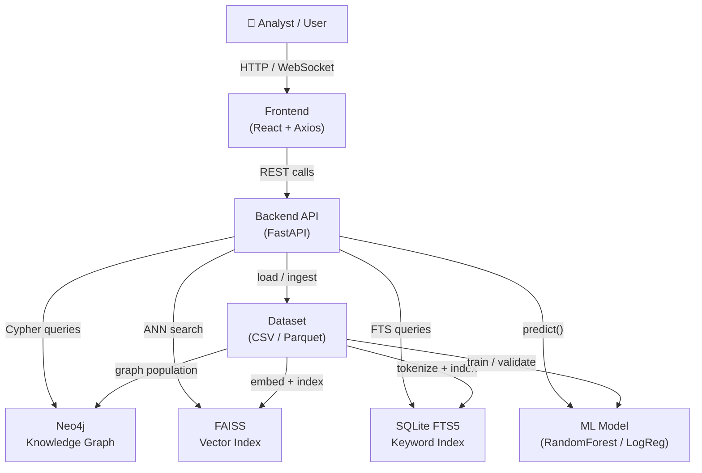
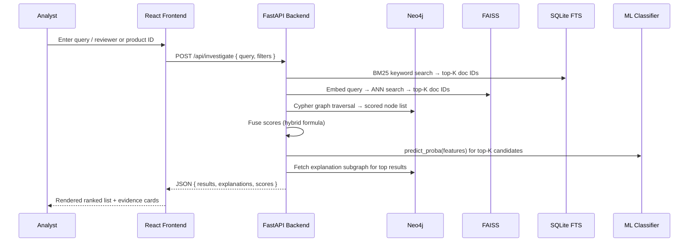

# ReviewGraph System Architecture

## 1. System Overview

ReviewGraph is a **Knowledge Graph–based Intelligent Review System (KGIRS)** designed to detect suspicious or computer-generated product reviews by combining structured knowledge graph traversal, semantic vector search, keyword retrieval, and a trained machine-learning classifier. The system ingests raw review datasets, constructs a Neo4j property graph, exposes a FastAPI backend, and surfaces investigation results through a React frontend. Explanations are generated from graph evidence, ensuring every claim made to the analyst is traceable to a concrete data source.

---

## 2. Component Diagram



---

## 3. Data Flow Diagram

The sequence below describes a **typical investigation request** — an analyst submits a query and receives ranked, explained results.



---

## 4. Backend Architecture

The backend is organised as a set of **service modules** under `reviewgraph/services/`:

### 4.1 `graph_service.py`
- Owns the `Neo4jConnection` singleton and all Cypher query helpers.
- Provides `build_graph(reviews_df)` to populate nodes and relationships in batch.
- Exposes `get_reviewer_profile(reviewer_id)`, `get_product_reviews(product_id)`, and `explain_suspicious_cluster(node_ids)`.

### 4.2 `retrieval_service.py`
- Orchestrates the three retrieval pipelines (keyword, semantic, graph) and the hybrid fusion layer.
- Manages the FAISS index lifecycle: build, persist to disk (`data/faiss.index`), and load on startup.
- Manages the SQLite FTS5 database (`data/fts.db`): schema creation, bulk insert, and `MATCH` queries.

### 4.3 `ml_service.py`
- Handles feature engineering (TF-IDF, lexical, temporal, behavioural features).
- Trains and evaluates classifiers (Logistic Regression baseline, Random Forest).
- Serialises the trained pipeline to `models/classifier.pkl` using `joblib`.
- Exposes `predict(review_features)` → `{"label": int, "probability": float}`.

### 4.4 `explainability_service.py`
- Accepts a list of result nodes and fetches their immediate neighbourhood from Neo4j.
- Maps graph patterns (shared co-reviewer, burst timing, rating anomaly) to human-readable template strings.
- Returns a structured `Explanation` object: `{ summary, evidence_edges, supporting_records }`.

### 4.5 `api/routes.py`
- Thin FastAPI route handlers that delegate to the above services.
- Handles request validation (Pydantic models), error mapping, and HTTP response serialisation.

---

## 5. Knowledge Graph Schema

### 5.1 Node Types

| Label | Key Properties | Description |
|-------|---------------|-------------|
| `Review` | `review_id` (str, unique), `text` (str), `rating` (float), `timestamp` (datetime), `label` (int), `suspicion_score` (float) | A single product review |
| `Reviewer` | `reviewer_id` (str, unique), `avg_rating` (float), `review_count` (int), `burst_flag` (bool) | The author of one or more reviews |
| `Product` | `product_id` (str, unique), `avg_rating` (float), `review_count` (int) | A reviewed product |
| `TextCluster` | `cluster_id` (int, unique), `centroid_embedding` (list[float]) | A FAISS-derived semantic cluster of similar review texts |

### 5.2 Relationship Types

| Relationship | From → To | Key Properties | Description |
|-------------|-----------|---------------|-------------|
| `WROTE` | `Reviewer → Review` | `timestamp` (datetime) | Reviewer authored the review |
| `REVIEWS` | `Review → Product` | `rating` (float) | Review is about the product |
| `CO_REVIEWED` | `Reviewer ↔ Reviewer` | `shared_product_count` (int), `overlap_score` (float) | Two reviewers both reviewed the same products |
| `SIMILAR_TO` | `Review ↔ Review` | `cosine_similarity` (float) | Reviews with embedding cosine similarity > threshold |
| `IN_CLUSTER` | `Review → TextCluster` | `distance` (float) | Review belongs to a semantic cluster |
| `RATED_SAME` | `Reviewer ↔ Reviewer` | `product_id` (str), `rating_delta` (float) | Two reviewers gave near-identical ratings to the same product |

---

## 6. Retrieval Pipeline

ReviewGraph implements three independent retrieval channels that are fused into a single ranked list.

### 6.1 Keyword Pipeline (BM25 / SQLite FTS5)
- Review texts are tokenised, stop-words removed, and inserted into an SQLite FTS5 virtual table.
- At query time, the user query is matched with `MATCH … AGAINST … IN BOOLEAN MODE`.
- Scores are the raw BM25 rank values returned by SQLite, then min-max normalised to [0, 1].

### 6.2 Semantic Pipeline (FAISS + Sentence Transformers)
- All review texts are embedded with `sentence-transformers/all-MiniLM-L6-v2` (384-dim).
- Embeddings are stored in a FAISS `IndexFlatIP` (inner product on L2-normalised vectors ≡ cosine similarity).
- At query time, the query string is embedded and the top-K nearest neighbours are retrieved.
- Cosine similarity scores are already in [−1, 1]; they are shifted and scaled to [0, 1].

### 6.3 Graph Pipeline (Neo4j Cypher)
- A multi-hop Cypher traversal starts from any `Reviewer` or `Product` node matching the query.
- It counts suspicious signals: `SIMILAR_TO` edges, `CO_REVIEWED` edges with high `overlap_score`, burst-timing flags.
- The raw signal count is normalised by the maximum observed count in the result set to produce a [0, 1] graph score.

### 6.4 Hybrid Fusion

Scores from the three pipelines are combined using a **weighted linear sum**:

```
combined_score = 0.25 × keyword_score
               + 0.40 × semantic_score
               + 0.35 × graph_score
```

**Weight Rationale:**
- Semantic score carries the most weight (0.40) because embedding similarity is the best proxy for copy-pasted or templated reviews.
- Graph score (0.35) captures structural collusion patterns invisible to text-only methods.
- Keyword score (0.25) handles exact phrase matches that embeddings may dilute.

Results are ranked by `combined_score` descending.  Ties are broken by `suspicion_score` from the ML classifier.

---

## 7. Explainability Engine

All explanations are **template-based** and **evidence-grounded** — every sentence in an explanation maps to at least one verifiable graph edge or source record.

### 7.1 Explanation Templates

| Pattern Detected | Template |
|-----------------|---------|
| High text similarity | "Review `{r1}` and `{r2}` share a cosine similarity of `{sim:.2f}`, suggesting copied or templated text." |
| Reviewer burst | "Reviewer `{rev}` posted `{n}` reviews within `{hours}` hours, a burst-timing anomaly." |
| Co-reviewer overlap | "Reviewers `{a}` and `{b}` both reviewed `{k}` of the same products (overlap score: `{s:.2f}`)." |
| Rating anomaly | "Reviewer `{rev}` has an average rating of `{avg:.1f}` vs. the product average of `{prod_avg:.1f}`." |
| Cluster membership | "This review belongs to text cluster `{cid}`, which contains `{n}` reviews with high mutual similarity." |

### 7.2 Evidence Grounding Process

1. Retrieve the subgraph neighbourhood (depth 2) of the flagged review node.
2. Identify all relationship types present and compute their property values.
3. Select the top-3 highest-confidence patterns.
4. Render template strings, injecting real property values from the subgraph.
5. Attach the raw `evidence_edges` list and `supporting_records` so the frontend can render a drill-down.

### 7.3 Hallucination Prevention

- Templates are the **only** text generation mechanism — no LLM is involved.
- Every injected value (`{sim}`, `{n}`, `{hours}`, etc.) is read directly from a Neo4j property or aggregation result.
- If a required property is missing, the template falls back to `"(data unavailable)"` rather than fabricating a value.

---

## 8. ML Pipeline

### 8.1 Feature Engineering

| Feature Group | Features | Method |
|--------------|---------|--------|
| Text | TF-IDF (top 5 000 unigrams + bigrams) | `TfidfVectorizer` |
| Lexical | review length (chars), word count, unique word ratio, exclamation count | Regex / string ops |
| Temporal | hour of day, day of week, days since first review | Timestamp parsing |
| Behavioural | reviewer review count, reviewer avg rating, product avg rating, reviewer rating deviation | Aggregation in graph |

### 8.2 Training

- **Baseline:** `LogisticRegression(C=1.0, max_iter=1000)` on TF-IDF only.
- **Primary model:** `RandomForestClassifier(n_estimators=200, max_depth=None, class_weight='balanced')` on all feature groups.
- **Class imbalance:** SMOTE oversampling applied to the training split only (never leaks into validation / test).
- **Split strategy:** Group-aware split by `reviewer_id` (70 % train / 15 % validation / 15 % test) to prevent data leakage.

### 8.3 Evaluation

- Metrics: Precision, Recall, F1-Score, PR-AUC, Confusion Matrix.
- Threshold tuning on the validation set (maximise F1).
- Final evaluation reported on the held-out test set only.

### 8.4 Persistence

```
models/
├── classifier.pkl        # joblib-serialised full pipeline (feature union + classifier)
├── tfidf_vectorizer.pkl  # standalone TF-IDF (used by retrieval service too)
└── label_encoder.pkl     # maps raw label strings to int
```

---

## 9. API Design

All endpoints are prefixed with `/api`.

| Method | Endpoint | Description |
|--------|---------|-------------|
| `GET` | `/health` | Liveness probe; returns service status and component connectivity |
| `POST` | `/investigate` | Main investigation endpoint; accepts query + filters, returns ranked results with explanations |
| `GET` | `/reviewer/{reviewer_id}` | Full profile for a reviewer: reviews, suspicion score, graph neighbourhood |
| `GET` | `/product/{product_id}` | All reviews for a product with aggregated suspicion indicators |
| `GET` | `/review/{review_id}` | Single review detail with explanation |
| `GET` | `/cluster/{cluster_id}` | Reviews belonging to a text cluster |
| `POST` | `/ingest` | (Admin) Trigger re-ingestion of dataset and graph rebuild |
| `POST` | `/train` | (Admin) Trigger model retraining; returns evaluation metrics |
| `GET` | `/stats` | System-wide statistics: total reviews, reviewers, products, graph edge counts |
| `GET` | `/similar/{review_id}` | Top-K most similar reviews by embedding distance |

**Request / Response format:** `application/json`. Pydantic models enforce schema validation on both sides.

---

## 10. Technology Stack

| Component | Technology | Version | Rationale |
|-----------|-----------|---------|-----------|
| Frontend | React | 18.x | Component-based UI, large ecosystem |
| HTTP Client | Axios | 1.x | Promise-based, interceptor support |
| Backend Framework | FastAPI | 0.110+ | Async-native, Pydantic validation, auto OpenAPI docs |
| ASGI Server | Uvicorn | 0.29+ | High-performance async server for FastAPI |
| Knowledge Graph DB | Neo4j Community | 5.x | Native graph storage, Cypher query language |
| Neo4j Driver | `neo4j` Python | 5.x | Official async-compatible driver |
| Vector Index | FAISS | 1.7+ | CPU-optimised ANN search, no external service needed |
| Keyword Index | SQLite FTS5 | (stdlib) | Zero-dependency full-text search |
| Embeddings | sentence-transformers | 2.x | Pretrained `all-MiniLM-L6-v2` (fast, lightweight) |
| ML Framework | scikit-learn | 1.4+ | Mature API, pipeline support, joblib serialisation |
| Class Balancing | imbalanced-learn | 0.12+ | SMOTE implementation |
| Data Processing | pandas, numpy | 2.x / 1.x | Standard data manipulation |
| Configuration | python-dotenv | 1.x | `.env`-based secret management |
| Testing | pytest, pytest-asyncio | 8.x | Async test support |

---

## 11. Security Considerations

### 11.1 Secret Management
- All credentials (Neo4j URI, username, password) are stored in a `.env` file, never committed to version control.
- `.env` is listed in `.gitignore`.
- The application reads secrets via `python-dotenv` at startup; no hardcoded credentials exist in source files.

### 11.2 Parameterised Queries
- All Cypher queries use **named parameters** (`$param`) rather than string interpolation, preventing Cypher injection.
- All SQL queries use **placeholder parameters** (`?`), preventing SQL injection.

### 11.3 Input Validation
- FastAPI + Pydantic enforces strict type checking, length limits, and regex constraints on all incoming request bodies and path/query parameters.
- Review text inputs are truncated to 5 000 characters before processing.

### 11.4 Rate Limiting & Auth (Future)
- The admin endpoints (`/ingest`, `/train`) should be protected by API-key middleware before production deployment.
- Rate limiting (e.g., `slowapi`) should be applied to the `/investigate` endpoint.

---

## 12. Performance Considerations

### 12.1 Caching
- The FAISS index is loaded into memory once at startup and reused across all requests.
- Neo4j query results for static resources (product profiles, reviewer profiles) are cached in a TTL-based in-process dictionary (60-second TTL).
- The ML model pipeline is loaded once into a module-level singleton.

### 12.2 Pagination
- The `/investigate` endpoint supports `limit` (default 20, max 100) and `offset` query parameters.
- The `/product/{id}` and `/reviewer/{id}` endpoints paginate reviews identically.

### 12.3 Graph Traversal Limits
- All Cypher traversal queries include a `LIMIT` clause (default 500 nodes) to prevent runaway queries on large graphs.
- Traversal depth is capped at 3 hops for pattern detection; deeper traversal requires explicit admin override.

### 12.4 Indexing
- Neo4j uniqueness constraints on `Review.review_id`, `Reviewer.reviewer_id`, and `Product.product_id` create implicit B-tree indexes.
- Composite index on `(Review.timestamp, Review.label)` accelerates burst-timing queries.
